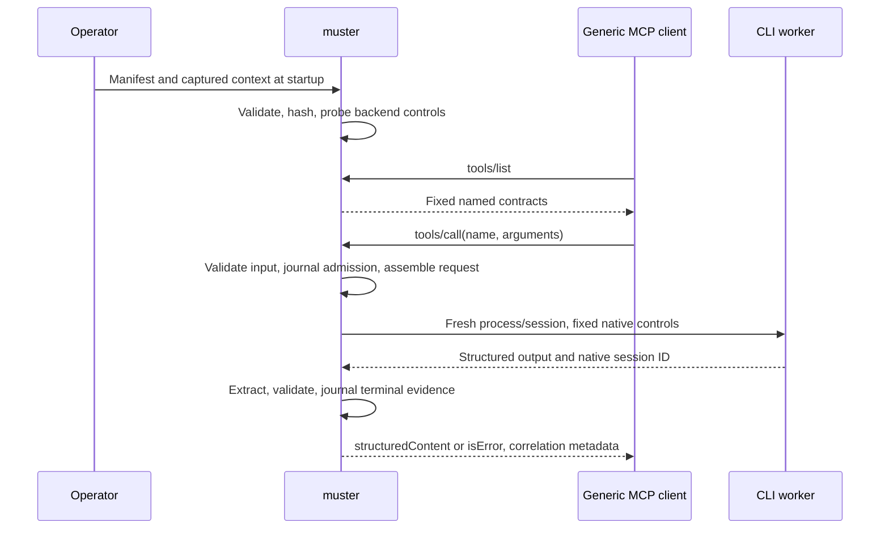

# Initial design and issue #1 traceability

The owner comment selects Claude first, then Codex behind an adapter interface.
This implementation adopts the recommended Go stack and keeps the manifest and
evidence format provisional. It lives in muster because lifecycle, deployment,
credentials and release ownership belong to this reusable MCP provider, not
Vessel's generic client. No new repository or language dependency is required.

Existing bridges named in issue #1 are useful general prompt launchers. The
needed layer here is the registered task contract: a stable named tool with
instructions, schemas, execution binding and checked results. The core does not
reimplement an agent harness. Claude/Codex native CLIs supply worker execution.

`worker.Backend` supplies capability checking and `Start`; its process provides
`Cancel` and `Wait`. The proxy owns contract validation, immutable context,
request assembly, job admission, one dispatch, result validation and evidence.
The SDK owns MCP negotiation and cancellation routing. A raw frame guard runs
before SDK decoding so duplicate keys cannot be lost to map decoding.

## Lifecycle and failures

The MVP admits one active job; overlap is rejected with `busy`, with no queued
work. It records `job-created`, `worker-started`, then `job-finished`. Rejected
inputs have a terminal-only record. The journal is serialized and synced before
worker dispatch; failure to record evidence prevents dispatch or success.

| Status | Meaning |
| --- | --- |
| `succeeded` | Local worker exited and output satisfied the declared schema. No factual correctness claim. |
| `invalid_input` | Arguments not an object, invalid JSON, schema mismatch or oversized assembled request. |
| `execution_failed` | Start failure, crash, nonzero exit, or worker-reported execution failure. |
| `output_contract_violation` | Missing/extraction-invalid output, duplicate keys, invalid JSON or result schema mismatch. |
| `timeout` | Job deadline elapsed; local exit is recorded separately. |
| `cancelled` | Caller/shutdown cancellation, with termination facts recorded separately. |
| `effect_uncertain` | A worker was started but its local termination was not observed. |
| `evidence_failure` | Required evidence could not be persisted; no successful result is returned. |
| `busy`, `shutting_down` | Dispatch refused before worker execution. |

Unknown tool names are SDK protocol errors. Malformed or duplicate-key JSON-RPC
frames close the connection and cannot dispatch a worker. Input/result failures
inside a valid call are MCP tool errors. There is no output repair, re-prompt,
fallback backend, or automatic retry, even for a read-only task. A caller retry
is a new job, not deduplicated: request IDs are protocol correlation, not effect
idempotency keys.

Cancellation kills the native process group and waits for the CLI. `CancelRequested`
and `WorkerTerminated` are separate facts. Descendants that intentionally escape
the process group and remote model activity are outside that guarantee. Control
plane billing/authentication/cache activity may already have happened. Neither
termination nor a read-only declaration is a rollback guarantee.

The evidence record binds tool/contract/instruction versions and hashes, local
job, backend/native session, request/arguments/result digests, context source
digests and capture times, execution times, local exit, cancellation and effect
status. Raw credential-bearing streams are never included in errors or JSONL.
The worker's source citations remain in the schema-defined MCP result; the
journal commits its digest rather than duplicating potentially sensitive text.
An abandoned admitted job with no terminal record remains unresolved after a
crash; muster does not replay or infer success from it.

## Enforcement and trust

The manifest, executable and context sources are operator-trusted. An executable
claiming to be Claude/Codex is not authenticated by a help-text probe. The
operator must install trusted native CLIs and provision authentication. Worker
output and call arguments never select a command, arbitrary CLI flags, tool
registration, permissions or session reuse. No task instruction is accepted as
a substitute for a native permission control.

Claude's no-tools profile refuses filesystem/network tool tasks. Codex's
read-only sandbox denies model shell writes, while approvals and live web
search are disabled; this does not pin the host filesystem. Process-wide OS
isolation, resource quotas and a narrower read scope require deployment controls
outside this MVP and are not claimed by its manifest. Context captured from
files is copied once and immutable in memory; its observed time/hash do not
establish that all external resources were frozen for the worker's lifetime.

The core neither advertises nor interprets Subsea Host policy metadata. It never
turns job progress into `/N`, inherits Scheduler policy, adopts Runtime outcomes
or rewrites Voyage plans. A policy-capable adapter must be a separate explicit
extension with actual enforcement. Optional Phase 5 and Vessel #67 integration
are not implied by generic MCP conformance.

## Validation boundary

`go test -race ./...` exercises raw stdio and the official generic SDK client:
registration/list/call, real separate fixture processes for both CLI protocols,
large/decimal number tokens, invalid input and output, duplicate keys, crash,
timeout, cancellation, native isolation flags, session separation, evidence
failure and non-disclosure of worker stderr. Fixture flags do **not** prove a
real agent's permission enforcement or model authentication. Real-worker and
permission-denial evidence must be recorded separately from these offline tests.

Deferred: pools/concurrent worker scheduling, session reuse, hot reload, HTTP,
MCP Tasks, effectful jobs, richer schemas, operator validators, restart recovery,
Subsea Host policies and Vessel #67 end-to-end evidence.
