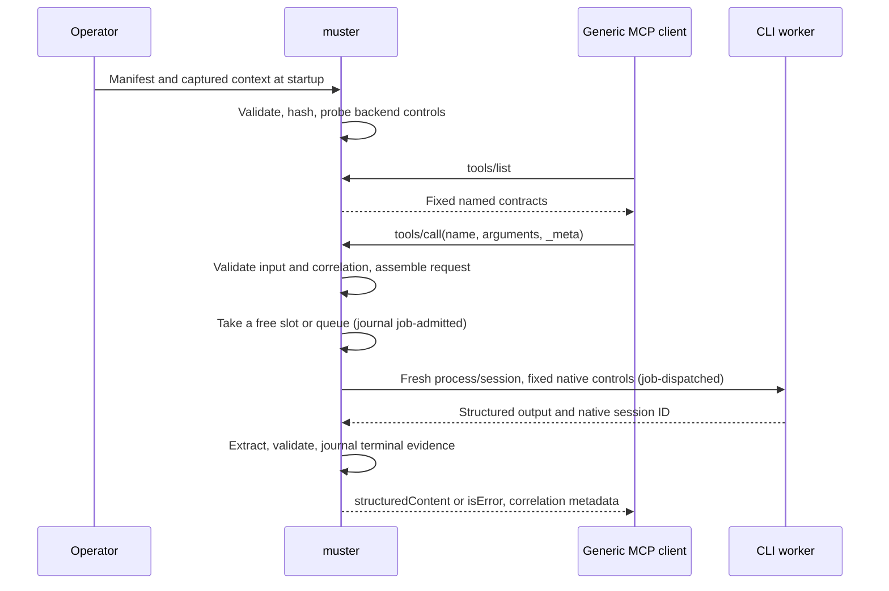

# Initial design and issue #1 traceability

The owner comment selects Claude first, then Codex behind an adapter interface.
This implementation adopts the recommended Go stack and keeps the manifest and
evidence format provisional. It lives in muster because lifecycle, deployment,
credentials and release ownership belong to this reusable MCP provider, not
Vessel's generic client. No new repository or language dependency is required.

Existing bridges named in issue #1 are useful general prompt launchers. The
needed layer here is the registered task contract: a stable named tool with
instructions, schemas, execution binding and checked results. The core does not
reimplement an agent harness. Claude/Codex native CLIs supply worker execution.

`worker.Backend` supplies capability checking and `Start`; its process provides
`Cancel` and `Wait`. The proxy owns contract validation, immutable context,
request assembly, job admission, one dispatch, result validation and evidence.
The SDK owns MCP negotiation and cancellation routing. A raw frame guard runs
before SDK decoding so duplicate keys cannot be lost to map decoding.

## Lifecycle and failures

Each muster instance is one MCP server with its own **credit**: `pool.workers`
execution slots shared by all of its tools (issue #3). A call that finds a free
slot is dispatched at once (push). When every slot is busy it waits in one FIFO
queue of at most `pool.queueLimit` calls, and the next slot released is handed
to the oldest waiting call (pull). A call beyond the queue is refused with
`overloaded` before any worker starts. There is no wait deadline: the caller
decides how long to wait and cancels. The execution deadline
(`timeoutSeconds`) starts at dispatch, not at admission. A slot is one CLI
process; every job still gets a fresh session.

Evidence version 2 records `job-admitted` (with any correlation values and the
queue position, 0 for an immediate slot), `job-dispatched`, then
`job-finished`. Calls refused before admission (input or correlation errors,
`overloaded`, `shutting_down`) have a terminal-only record. The journal is
serialized and synced before worker dispatch; failure to record evidence
prevents dispatch or success. A short write, I/O or sync failure latches the
journal closed: subsequent records cannot be appended to a potentially damaged
JSONL stream.

Correlation is generic. The operator lists request `_meta` keys
(`correlation.metaKeys`); a present value must be a printable string of at most
256 bytes and is recorded uninterpreted in every record of that job, from
admission on. A malformed value refuses the call (`invalid_correlation`): a job
whose evidence could not be joined to its caller does not run. Other `_meta`
keys are never recorded. A caller such as a Subsea Runtime can therefore join
its own call record to the muster job even when no result ever returns.

| Status | Meaning |
| --- | --- |
| `succeeded` | Local worker exited and output satisfied the declared schema. No factual correctness claim. |
| `invalid_input` | Arguments not an object, invalid JSON, schema mismatch or oversized assembled request. |
| `execution_failed` | Start failure, crash, nonzero exit, or worker-reported execution failure. |
| `output_contract_violation` | Missing/extraction-invalid output, duplicate keys, invalid JSON or result schema mismatch. |
| `timeout` | Job deadline elapsed; local exit is recorded separately. |
| `cancelled` | Caller/shutdown cancellation, with termination facts recorded separately. |
| `effect_uncertain` | Parent exit or full process-group termination could not be confirmed, or output pipes outlived the parent. `failureKind:worker_io_timeout` distinguishes an `ErrWaitDelay`. |
| `evidence_failure` | Required evidence could not be persisted; no successful result is returned. |
| `permission_violation` | The worker exposed or used a tool outside its declared permissions; the job was stopped when observed. |
| `invalid_correlation` | A configured `_meta` key held a value that cannot be recorded; refused before admission. |
| `overloaded` | Every slot busy and the queue full; refused before admission. No worker ran. |
| `cancelled_before_dispatch` | Cancelled while queued (or between admission and dispatch). No worker ran, so no effect happened. |
| `shutting_down` | Refused, or ended in the queue, at shutdown. No worker ran. |

Unknown tool names are SDK protocol errors. Malformed or duplicate-key JSON-RPC
frames close the connection and cannot dispatch a worker. Input/result failures
inside a valid call are MCP tool errors. There is no output repair, re-prompt,
fallback backend, or automatic retry, even for a read-only task. A caller retry
is a new job, not deduplicated: request IDs are protocol correlation, not effect
idempotency keys.

Cancellation requests process-group termination. Normal and failed exits also
clean up the group. Linux `waitid(WNOWAIT)` and macOS `NOTE_EXIT` observe exit
without reaping; the group is signalled while its leader still reserves the
PID/PGID. Cancellation is disabled once exit is settled, before `Cmd.Wait`
reaps it, preventing later signals to a recycled group ID. The proxy uses this
settled cancellation reason instead of re-reading a possibly later context
deadline. `parentExited`, `cancelRequested` and `workerTerminated` are separate
facts. Only observed group absence plus parent exit establishes termination; a
remaining zombie group is conservatively uncertain. `ErrWaitDelay` is recorded
separately and never turned into success. Descendants that intentionally escape
the process group and remote model activity are outside that guarantee. Control
plane billing/authentication/cache activity may already have happened. Neither
termination nor a read-only declaration is a rollback guarantee.

The evidence record binds tool/contract/instruction versions and hashes, local
job, backend kind/resolved executable/version/native session, request/arguments/result digests, context source
digests and capture times, execution times, local exit, cancellation and effect
status. Raw credential-bearing streams are never included in errors or JSONL.
The worker's source citations remain in the schema-defined MCP result; the
journal commits its digest rather than duplicating potentially sensitive text.
An abandoned admitted job with no terminal record remains unresolved after a
crash; muster does not replay or infer success from it.

## Effects: web read

Workers do real work, and real work has effects. muster declares them
instead of assuming none. The first effect profile after `no-tools` is
**web read** (`permissions:"web-read"`, `effect:"external-read"`,
`resources:"captured-context+web"`, Claude only). The worker session has only
`WebSearch` and `WebFetch` (`--tools`), `--permission-mode dontAsk` refuses any
use the allow rules do not cover, and `binding.webFetchDomains` narrows WebFetch
to listed hosts (`WebFetch(domain:...)`). Sending a search or fetching a page is
an external request: a GET can still have server-side effects, and nothing is
rolled back. The catalog says so in the tool description and in MCP
annotations (`readOnlyHint:true`, `openWorldHint:true`, `destructiveHint:false`,
no `idempotentHint`).

A web-read worker runs with `--output-format stream-json --verbose`. muster reads
the event stream line by line as it arrives and keeps only what extraction and
evidence need:

- The session's `init` event must list no tool beyond the declared ones, and
  each `tool_use` must name one of them. Otherwise the job is stopped at once
  and ends `permission_violation`. `StructuredOutput` is the extraction channel,
  not an effect.
- Each tool use becomes an `effects` entry: tool, target (URL or search query,
  in clear), input hash, observed request and completion times, result hash,
  and status `requested` / `ok` / `error` / `denied`. `observedUrls` lists URLs
  found in the result text (a heuristic for citation checks, not a record of
  every page the remote service read). Result bodies are not stored.
- A use still `requested` when the job ends (cancellation, timeout) may have
  reached the remote service; the entry is kept for that reason.
- Native refusals are listed in `deniedTools` and mark their effect `denied`.

Queries and URLs are recorded in clear so external requests can be audited.
They can contain sensitive terms from the arguments; the evidence file is
private (0600) for that reason. Write and state-changing effects are later work
on the same declaration, enforcement and recording pattern.

## Enforcement and trust

The manifest, executable and context sources are operator-trusted. An executable
claiming to be Claude/Codex is not authenticated by a help-text probe. The
operator must install trusted native CLIs and provision authentication. Worker
output and call arguments never select a command, arbitrary CLI flags, tool
registration, permissions or session reuse. No task instruction is accepted as
a substitute for a native permission control.

Claude's no-tools profile uses safe mode and explicit memory controls while
retaining native authentication. Backend-specific environment allowlists prevent
inheriting parent sessions and unrelated credentials; operator-selected provider
bindings remain explicit. Codex is experimental and declares the host
filesystem readable. A read-only sandbox does not confine reads to its temporary
cwd; the shell/apply-patch feature settings have not been behaviorally verified.
Actual denial evidence is required before stronger claims can replace this
explicit scope. Process-wide isolation, resource quotas and a narrower read
scope require deployment controls outside this MVP. Captured context remains
immutable, but its observation time/hash does not freeze other host resources.

The core neither advertises nor interprets Subsea Host policy metadata. It never
turns job progress into `/N`, inherits Scheduler policy, adopts Runtime outcomes
or rewrites Voyage plans. A policy-capable adapter must be a separate explicit
extension with actual enforcement. Optional Phase 5 and Vessel #67 integration
are not implied by generic MCP conformance.

## Validation boundary

`go test -race ./...` exercises raw stdio and the official generic SDK client:
registration/list/call, real separate fixture processes for both CLI protocols,
large/decimal number tokens, invalid input and output, duplicate keys, crash,
timeout, cancellation, native isolation flags, session separation, evidence
failure and non-disclosure of worker stderr. Fixture flags do **not** prove a
real agent's permission enforcement or model authentication. Real-worker and
permission-denial evidence must be recorded separately from these offline tests.

Deferred: session reuse or resident workers, externally attached pull
workers, hot reload, HTTP, MCP Tasks, write/state-changing effects, Codex web
access, richer schemas, operator validators, restart recovery, Subsea Host
policies and Vessel #67 end-to-end evidence.
